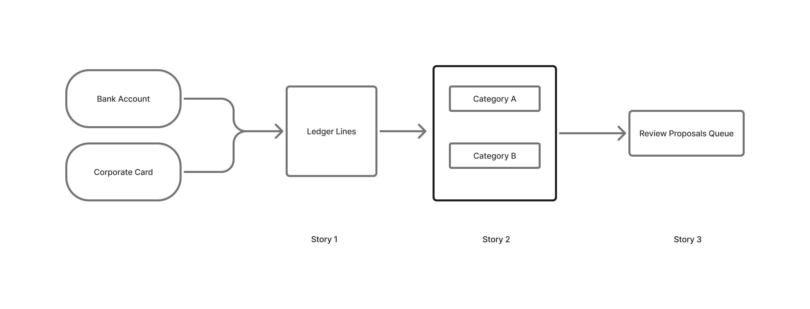
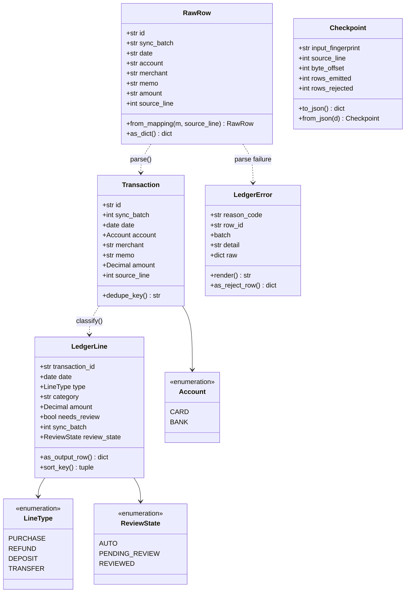
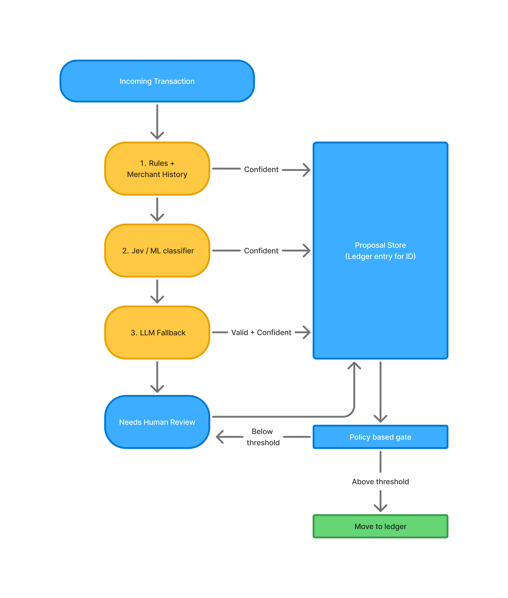

# Ledger — EXP-412 Story 1

Turns a restaurant operator's raw transaction feed into categorized ledger lines.



## How to run

Needs Python 3.11+. Set up a virtual environment and install:

```bash
python3 -m venv .venv
source .venv/bin/activate          # Windows: .venv\Scripts\activate
pip install -e ".[dev]"            # or: make install
```

Then run it and the tests:

```bash
python -m ledger data/transactions.csv -o ledger_lines.csv   # or: make run
python -m pytest                                             # or: make test
```

Full form: `python -m ledger INPUT.csv [options]`.

| Option | Default | What it does |
|--------|---------|--------------|
| `INPUT` (positional) | — | Path to the input feed CSV. Required. |
| `-o`, `--output` | `ledger_lines.csv` | Where to write the ledger output. |
| `--rejects` | `rejected_rows.csv` next to the output | Where to write rows we couldn't process. |
| `--resume` | off | Resume a prior interrupted run against the same input. |
| `-v`, `--verbose` | off | Debug-level logging. |
| `-h`, `--help` | — | Show usage and exit. |

Exit codes: `0` clean, `1` finished but some rows were rejected, `2` fatal (missing
file or missing columns).

Anything we can't process goes to `rejected_rows.csv`
with a reason.


## Scale and accuracy

Load-tested on generated feeds up to 1M rows on synthetic data to check for scale. Accuracy is checked against an independently written copy of the rules.

| Metric | Result (at 1,000,000 rows) |
|--------|----------------------------|
| Throughput | ~55,000 rows/second, single pass |
| Memory | ~0.6 KB per unique id; streams row by row |
| Classification accuracy | 100% |
| Dedupe accuracy | 100% |
| Date integrity | 100% |
| Amount integrity | 100% |
| Broken rows rejected (bad amount, NaN/Inf, bad date, unknown account, formula injection) | 1,000 / 1,000 |
| Broken rows leaked into ledger | 0 |
| Good rows silently dropped | 0 |
| Rerun / crash-resume | Byte-identical output, never double-counts |

The pipeline streams row by row as generators, so memory tracks unique ids rather than file
size. Money is parsed as Decimal and the feed's values are carried through
untouched, so amounts and dates can't drift. The one stateful step, dedupe, keeps
the highest sync_batch per id and is order-independent, so re-syncs collapse
cleanly. Output is written to a temp file and swapped in atomically, keyed by
transaction_id — that's what makes reruns and crash-resume byte-identical and
double-count-proof. Bad rows raise typed errors and divert to a rejects file
instead of crashing the run. And the numbers aren't self-graded: an independently
written copy of the rules checks every row, so accuracy means agreement between
two separate implementations, not the code trusting itself.

## What I found unclear or wrong, and would ask before merging

- **"Memo says PAYMENT or TRANSFER → transfer" is wrong as written.** Row txn_1022
  is MAINLINE PROPERTIES (rent) with the memo "ACH PAYMENT MAINLINE PROPERTIES".
  Taken literally, the rule books $6,500 of rent as a transfer. When a
  transfer-looking memo lands on a merchant that's on the expense list, I treat it
  as a conflict and send it to review instead of guessing. Would ask: is review
  right here, or should it just use the merchant's category?
- **Are the sync batches deltas or full snapshots?** I assumed deltas: batch 2 is
  only 12 rows, clearly not a replacement for batch 1's 48, so an id that
  disappears in a later batch is kept, not treated as cancelled. If they're full
  snapshots, that flips.
- **The sign convention is the same on both accounts** (positive = money out),
  which is unusual for a bank. It holds across the sample; I check it at parse time
  but would confirm with whoever sends the feed.
- **A few cases don't appear in the sample**, so I picked a behavior and would
  confirm: a positive payout (a clawback) is flagged for review, a duplicate id
  inside one batch keeps the last row and logs the other.

## Where I used AI and where I overrode it

AI wrote most of the scaffolding, the error handling, the logging, and a lot of
the test bodies. I drove the design decisions and the verification.

The main override was the transfer rule. The first pass followed the spec
literally (memo only), which misclassifies the MAINLINE rent row.


## Checks for accuracy
The first 15 output rows are diffed
byte-for-byte against `expected_first_15.csv`, and the accuracy and fault
numbers above come from actually running it, not from reading the code.


## Data model (class diagram)

The dataclasses and the enums they use. `RawRow` is the feed as received;
`Transaction` is parsed/typed; `LedgerLine` is the output (its CSV projection is
the six required columns, but it carries `sync_batch` and `review_state` so
Stories 2–3 are a column addition, not a migration). `Checkpoint` is resume state.



## Future Architecture with AI fallback


