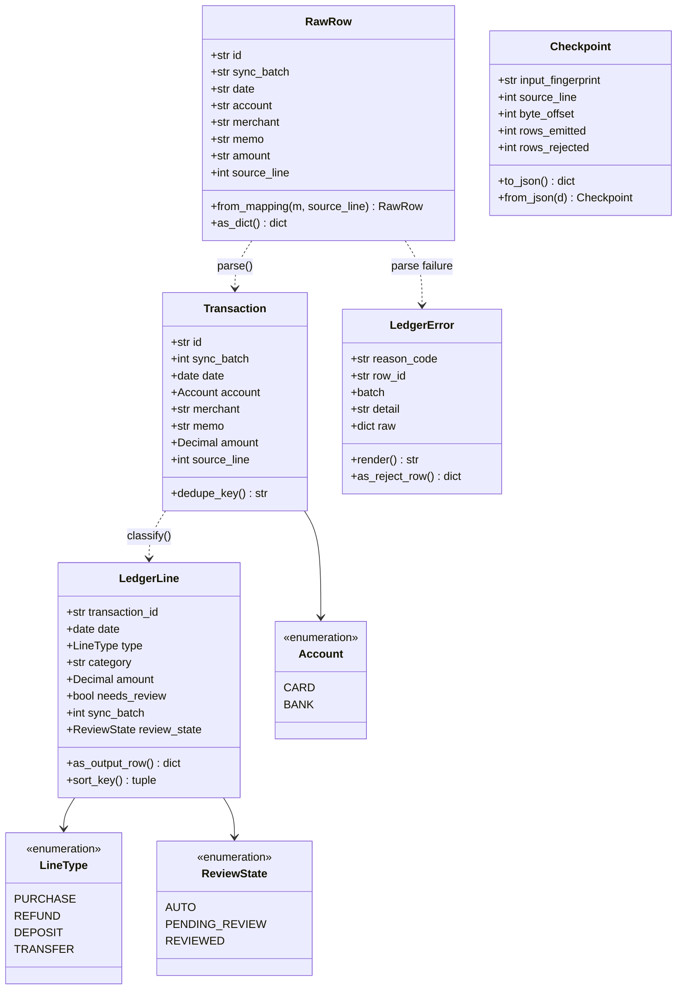
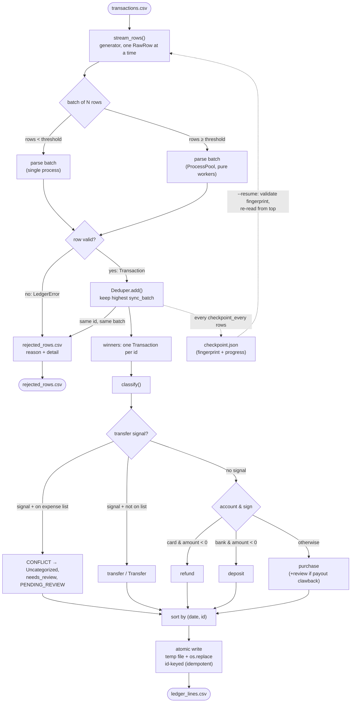

# Technical Design — EXP-412 Story 1: Ingest the feed and produce ledger lines

## 1. Intent (extracted from `task.md`)

The story text is written as an operator-facing feature, not a spec. Reading
through the prose, the real intent is:

> **Turn a messy, re-syncing dual-account transaction feed into a clean,
> trustworthy, one-line-per-transaction ledger — getting the obvious cases right
> automatically and routing the uncertain ones to a human rather than guessing.**

Three things that intent implies, which the literal rules don't say outright:

1. **Trust over coverage.** A bookkeeper reviews the uncertain lines, so the
   system's job is to be *right or honest*, never confidently wrong. "Silently
   dropping money rows is worse than a loud failure" is the operating principle.
2. **Determinism.** "Sort so reruns diff cleanly" and the pending/posted re-sync
   model only make sense if the same input always yields the same output.
3. **A seam for the future, not the future itself.** The LLM categorizer and the
   review queue (Stories 2–3) are coming; Story 1 must not need a rewrite to
   accommodate them.

## 2. Success metrics

Each metric traces to a sentence of intent and is checked by a test or an
end-to-end run (status as of the current build).

| # | Metric | Target | How measured | Status |
|---|--------|--------|--------------|--------|
| M1 | **Format/correctness parity** | First 15 output rows byte-identical to `expected_first_15.csv` | `test_pipeline_golden.py::test_golden_first_15` | ✅ identical |
| M2 | **One id → one line** | Output row count == distinct input ids (56 of 60 here) | `test_output_row_count_equals_unique_ids` | ✅ 56 |
| M3 | **Correct dedupe** | Highest `sync_batch` wins; late low batch never overrides; 10 > 9 | `test_dedupe.py` (6 cases) | ✅ |
| M4 | **Idempotency** | Run twice → byte-identical file; resume → identical | `test_properties.py` (2 cases) | ✅ |
| M5 | **Order-independence** | Shuffled input → identical output | `test_shuffled_input_gives_same_output` | ✅ |
| M6 | **Money exactness** | `Decimal` only; exactly 2 decimals; no `-0.00`; `0.10+0.20==0.30` | `test_parse` + `test_properties` | ✅ |
| M7 | **No silent drops** | Every unprocessable row in `rejected_rows.csv`; non-zero exit | `test_cli.py::test_rejected_rows_exit_one` | ✅ exit 1 |
| M8 | **Never crashes abruptly** | Bad rows don't sink the run; only missing file/columns are fatal, and cleanly (exit 2, no stack dump of lost data) | `test_cli.py` (fatal cases) | ✅ |
| M9 | **Trust on ambiguity** | memo/merchant conflict (MAINLINE) and unknown-merchant refund/deposit → `needs_review=true` | `test_classify.py` | ✅ |
| M10 | **No false merchant matches** | Word-boundary prefix; "SYSCOLOR" ≠ "SYSCO" | `test_categorize_word_boundary_no_false_prefix` | ✅ |
| M11 | **Scales** | Streaming (flat memory); parallel path gives identical output | forced-parallel run diffed vs serial | ✅ identical |
| M12 | **Forward-compatible** | `sync_batch` + `review_state` carried in the model; categorize() is one isolated function | code review / design | ✅ seam in `categorize.py` |

Non-goals (explicitly out of scope per the story): the LLM categorizer, the
split-across-categories feature (Story 2), and the review queue UI (Story 3).

## 3. Data model (class diagram)

The dataclasses and the enums they use. `RawRow` is the feed as received;
`Transaction` is parsed/typed; `LedgerLine` is the output (its CSV projection is
the six required columns, but it carries `sync_batch` and `review_state` so
Stories 2–3 are a column addition, not a migration). `Checkpoint` is resume state.



## 4. Processing flow (flowchart)



## 5. Key design choices and why

- **Generators end to end; dedupe is the one stateful stage.** Memory stays flat
  regardless of feed size. "Keep highest batch" is associative, which is what
  makes M4 (idempotency) and M5 (order-independence) hold for free.
- **Atomic, id-keyed write.** Output goes to a temp file and is `os.replace`d in
  (atomic on POSIX). Keying each line by `transaction_id` on the final write is
  the idempotency backstop: a row emitted twice (e.g. a sloppy resume) collapses
  to one line. This is why resume can re-read from the top instead of needing a
  fragile exact-offset seek.
- **Parallelism only where it pays.** Parse and classify are pure per-row
  functions → safe to run in a process pool over batches, above a row threshold.
  Dedupe and the final sort are serial and authoritative, so M11 (identical
  parallel output) holds. For the 60-row sample the pool is skipped entirely —
  spinning up processes would be slower than the work.
- **One error class per failure, one base for formatting.** `LedgerError`
  subclasses (`MalformedAmountError`, `UnknownAccountError`,
  `DuplicateInBatchError`, …) each carry a stable `reason_code`; the base renders
  the log line and the `rejected_rows.csv` row identically. Parsing is split into
  one function per failure mode so each is unit-testable in isolation (M7, M8).
- **Transfer = memo *and* merchant agreement.** The spec's memo-only rule
  misclassifies MAINLINE rent; the agreement check routes genuine conflicts to
  review instead of guessing (M9). This is the main place the implementation
  deliberately diverges from the literal story.
- **Forward-compatible model.** `LedgerLine` carries `sync_batch` and
  `review_state` even though Story 1's CSV projects only six columns, and
  `categorize()` is the single isolated seam for the future LLM step (M12). No
  schema migration is needed to add the review queue.

## 6. Risks / open questions (carried from the design decisions)

1. Are sync batches **deltas or full snapshots**? We assume deltas (a vanished id
   is kept, not cancelled). A full-snapshot feed flips this.
2. For a memo/merchant **conflict**, is `needs_review` right, or force the
   merchant's category?
3. The **sign convention** (positive = out on both accounts) is unusual for a
   bank; verified on this feed, asserted at parse, worth confirming with the
   provider.
4. **Positive payout (clawback)** and **unpaired transfer legs** are flagged for
   review but don't appear in the sample — behavior is defensive and unconfirmed.
```
